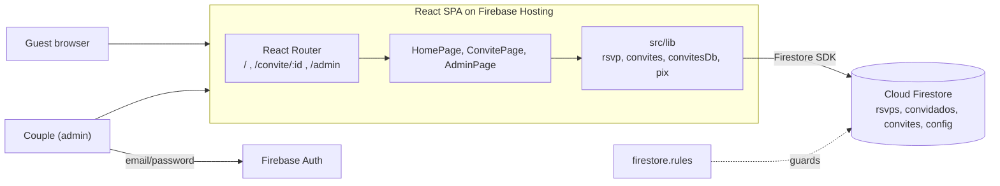
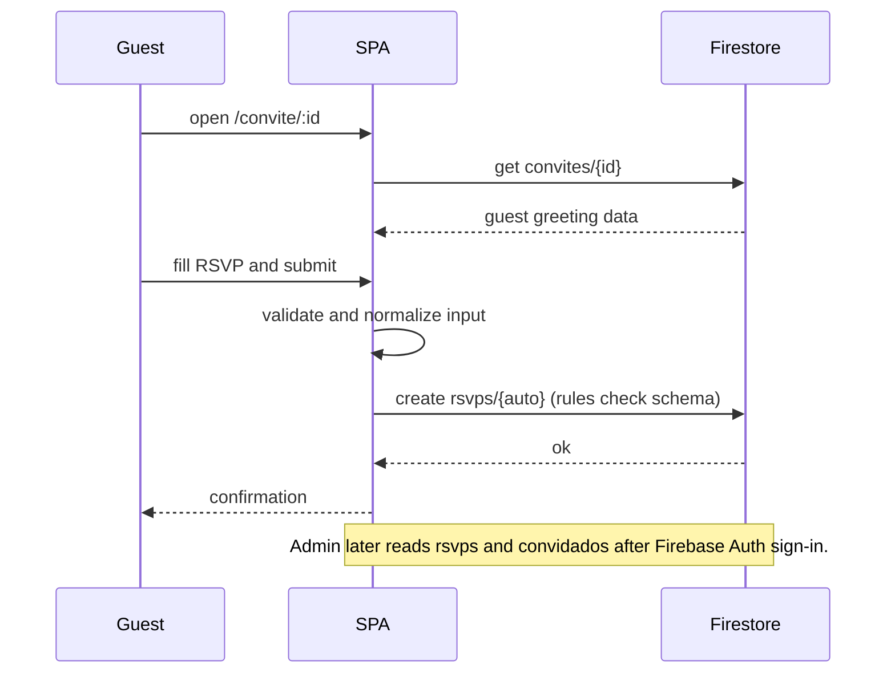
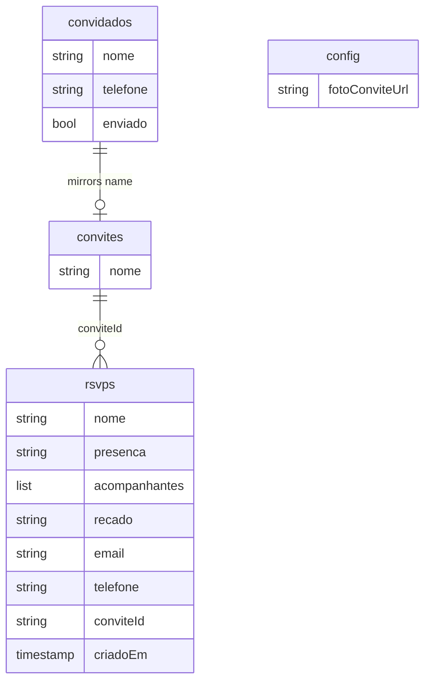

# Wedding RSVP Site

Single-page wedding site with a personal invitation link per guest, an RSVP form and a small admin panel for the couple.

**Status:** Prototype built for a private event, published here with all event data replaced by placeholders. Not in production from this repository. Each submission creates a new RSVP document (no upsert per invitation); a stricter model is a known gap.

## What it does

- Home page: hero, countdown, story, venue, gifts (PIX QR generated client-side) and gallery (`src/HomePage.tsx`, `src/components/`).
- Personal invitation page `/convite/:id` that greets the guest by name and links to the RSVP (`src/components/ConvitePage.tsx`).
- RSVP form with companions, message and contact, validated before write (`src/components/Rsvp.tsx`, `src/lib/rsvp.ts`).
- Admin area `/admin` behind Firebase Auth: guest list import, WhatsApp message links, sent flag, RSVP totals and CSV export (`src/admin/`).
- PIX "copy and paste" payload builder with CRC16 (`src/lib/pix.ts`).
- Scroll-reveal sections and an SVG/starfield visual identity.

## Architecture



- No custom backend: the browser talks to Firestore directly; authorization lives in `firestore.rules`.
- Public writes are limited to creating an RSVP with a strict schema and size limits; reads and updates are admin-only.
- Invitation documents are readable only by exact `get` (no listing), so a link is a bearer credential; this is a known limit.
- Pure helpers (CSV, phone/WhatsApp, PIX payload, totals) are separated from Firebase calls and unit tested.

### Core flow: guest opens a link and answers



### Data model (Firestore collections)



Current limitation: each submission creates a new `rsvps` document (no upsert per invitation).

## Key engineering decisions

- Serverless by design (Hosting + Firestore + Auth) to keep operations near zero: `firebase.json`.
- Security in Firestore Rules with field allow-lists and size caps: `firestore.rules`.
- Guest data kept out of the repo: private CSVs and caches are git-ignored (`.gitignore`); event content is centralized in `src/content.ts`.
- Event data is configuration, not code: names, date, venue, PIX and WhatsApp come from `VITE_*` env vars with neutral defaults (`src/content.ts`, `.env.example`).

## Tech stack

React 19, TypeScript, Vite, Tailwind CSS 4, shadcn/Radix primitives, React Router, Firebase (Hosting, Auth, Firestore), `qrcode`, Vitest, oxlint.

## Getting started

Prerequisites: Node >= 20, pnpm, a Firebase project with Firestore and email/password Auth.

```bash
pnpm install
cp .env.example .env    # fill your Firebase web config
pnpm dev                # http://localhost:5173, admin at /admin
```

| Name | Purpose |
|---|---|
| `VITE_FIREBASE_API_KEY`, `VITE_FIREBASE_AUTH_DOMAIN`, `VITE_FIREBASE_PROJECT_ID` | Firebase web app config |
| `VITE_FIREBASE_STORAGE_BUCKET`, `VITE_FIREBASE_MESSAGING_SENDER_ID`, `VITE_FIREBASE_APP_ID` | Firebase web app config |

Event configuration (all optional, placeholders are used when empty; see `.env.example`):

| Name | Purpose |
|---|---|
| `VITE_SITE_TITLE` | Page title and link-preview title |
| `VITE_PARTNER_A`, `VITE_PARTNER_B` | Names shown on the invitation page and footer |
| `VITE_EVENT_DATE_ISO` | Event date-time (ISO 8601); drives countdown and labels |
| `VITE_VENUE_NAME`, `VITE_VENUE_CITY`, `VITE_VENUE_ADDRESS` | Venue block |
| `VITE_VENUE_MAPS_QUERY` | Google Maps query, e.g. `lat,lng` |
| `VITE_PIX_KEY`, `VITE_PIX_RECEIVER_NAME`, `VITE_PIX_RECEIVER_CITY` | PIX payload for gifts |
| `VITE_NOTIFY_WHATSAPP` | WhatsApp number (with country code) that receives contribution notices and RSVP contact |

Vite inlines these at build time, so they are public in the built site.

### Admin account

`firestore.rules` contains the placeholder `REPLACE_WITH_ADMIN_UID`. Create the admin user in Firebase Authentication, copy its UID, replace the placeholder in `firestore.rules`, and deploy the rules. Set your project id with `firebase use --add` (no `.firebaserc` is committed).

## Testing

6 test files, 30 tests: RSVP validation, invitations and WhatsApp helpers, PIX payload, CSV/totals, countdown.

```bash
pnpm lint && pnpm test && pnpm build
```

## Project structure

```text
src/components  sections and pages (Hero, Rsvp, ConvitePage, ...)
src/admin       admin panel and CSV helpers
src/lib         rsvp, invitations, Firestore access, PIX
src/content.ts  event content
firestore.rules security rules
```

## License

All rights reserved. Source available for portfolio review.
